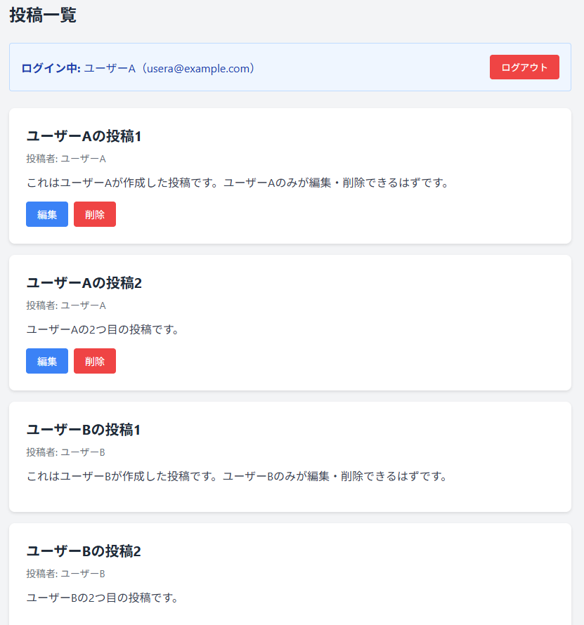

# authorization-app-practice

## 概要
COACHTECH 教材 Tutorial 10-3「認可機能 ハンズオン演習」で作成した成果物です。

認可機能を使って認可スターターを作成した。

## 使用技術

PHP 8.5.12 
Laravel 10.x 
Policy / Gate（認可） 
Laravel Fortify（認証）

## 学んだこと

・AIに説明してもらったりして、認証と認可の違いを理解した。 
・コード自体はシンプルそうだが、書くべき場所がわからない。 
・認証と合わせて勉強する。

## 動作確認

ブラウザを開いて確認した。 

 
 
 
